# Awesome-AI-Desktop-Agents-UI-Automation

  

  
  
  
  
  

---

## 🌟 Top AI Desktop Agents & UI Automation Ecosystem

> **A Curated, SEO-Optimized List of SaaS Platforms & Open-Source Projects for Autonomous Computer-Using Agents, Multimodal GUI Vision-Action Models, Native OS Accessibility Automation, Sandboxed Virtual Desktops & Cross-Platform UI Testing.**

**Last updated:** November 2026 🚀

This repository serves as an authoritative directory tracking production **SaaS platforms** and bleeding-edge **open-source repositories** powering **AI Desktop Agents & UI Automation**. These technologies enable next-generation multimodal AI agents to perceive pixel-level desktop screens, parse native Windows / macOS / Linux GUI hierarchies, control mouse and keyboard inputs via visual grounding or OS accessibility trees, and execute safely inside isolated cloud virtual desktop environments.

Notable industry touchpoints include Anthropic Computer Use, OpenAI Operator / CUA, Adept, MultiOn, Simular, HyperWrite, Induced AI, Lindy, Browserbase, Playwright Cloud, and trycua/cua.

---

## 📑 Table of Contents
- [Sector Overview & Market Dynamics](#-sector-overview--market-dynamics)
- [SaaS & Hosted Platforms](#-saas--hosted-platforms)
- [Open-Source GitHub Projects](#-open-source-github-projects)
- [Star History](#-star-history)
- [How to Contribute](#-how-to-contribute)
- [Support](#-support)
- [Disclaimer](#-disclaimer)

---

## 📊 Sector Overview & Market Dynamics

The global AI agents and autonomous computer-use market is experiencing explosive expansion, valued between **$7.6 billion and $11.5 billion in 2026** and projected to exceed **$50 billion by 2030** at a compound annual growth rate (CAGR) of over **44%**. 

The sector remains **highly fragmented**: frontier foundation model providers (OpenAI, Anthropic) establish baseline vision-action reasoning primitives, while an aggressive landscape of vertical startups and open-source ecosystems compete fiercely across headless browser execution, enterprise RPA replacement, cloud sandbox virtualization, and local OS accessibility automation—preventing any single winner-take-all consolidation at this stage.

---

## ☁️ SaaS & Hosted Platforms

The table below summarizes leading hosted and enterprise-grade AI desktop agent solutions, ranked by **Company Scale (Valuation / Total Capitalization)** in descending order.

| Company / Product | Description | Scale (Valuation / Funding) | Starting Paid Pricing | Free Tier / Trial Limits |
| :--- | :--- | :--- | :--- | :--- |
| 🤖 **[OpenAI Operator & CUA](https://openai.com)** | Flagship cloud AI agent system combining GPT-4o / o-series vision reasoning with reinforcement-learned GUI interaction to operate browsers and desktop workflows autonomously. | **~$157 Billion Valuation** ($6.6B+ Series round, >$3.7B run-rate) | **$20/mo** (ChatGPT Plus) / **$200/mo** (ChatGPT Pro for Operator) / Usage-based API ($2.50 / 1M input tokens) | **Free Forever Tier**: Access to GPT-4o mini with rate-limited access to GPT-4o (no free Operator access) |
| 🧠 **[Anthropic Computer Use](https://anthropic.com)** | Multimodal vision-and-action capability via Claude API allowing Claude 3.5/3.7 Sonnet models to inspect desktop screenshots, resolve coordinates, and execute clicks and keystrokes. | **~$60 Billion Valuation** ($7.6B+ total raised, >$1B ARR run-rate) | **Usage-based API**: Claude 3.5 Sonnet starting at **$3.00 / million input tokens** and **$15.00 / million output tokens** | **$5 Free API Credits** on initial signup (valid for 14 days; requires phone verification) |
| 🏢 **[Adept AI](https://adept.ai)** | Enterprise multimodal software-control agent pioneer whose core team and agent IP technology were absorbed by Amazon AGI Autonomy. | **~$1.0 Billion Peak Valuation** ($415M raised; acquired/licensed by Amazon) | **Enterprise / Custom Licensing** (Core engineering absorbed into Amazon AGI) | **30-Day Enterprise POC / Demo Sandbox** available upon formal sales qualification |
| ⚡ **[Browserbase](https://browserbase.com)** | Serverless headless browser cloud infrastructure built for AI agents and Stagehand automation featuring session replays, stealth mode, and persistent contexts. | **~$100 Million Valuation** ($21M Series A raised led by Kleiner Perkins) | **$20/mo** (Starter Plan with 20 browser hours included; additional hours billed at $0.06/hr) | **Free Forever Tier**: 1 free browser hour/month, up to 3 concurrent sessions, capped at 15 minutes per session max |
| 🖥️ **[Simular AI](https://simular.ai)** | Cloud and native desktop AI computer-use platform (Sai) built on Agent S architecture capable of executing multi-app workflows across macOS and Windows. | **~$80–$100 Million Est. Valuation** ($26.5M total funding; $21.5M Series A led by Felicis & NVentures) | **$50/mo** (Starter Plan with persistent cloud desktop VM workspace) | **7-Day Free Trial** with 25 free agent run executions (requires signup verification) |
| 🪄 **[MultiOn](https://multion.ai)** | Cloud personal and enterprise web-agent platform enabling AI agents to autonomously navigate complex websites, fill forms, and run online tasks via API. | **~$50–$60 Million Est. Valuation** ($10M+ raised from General Catalyst, Samsung NEXT) | **$20/mo** (Pro Tier) / API usage from **$0.05 per autonomous step** | **Free Forever Sandbox Tier**: 40 free agent actions/month on browser playground |
| 🔄 **[Induced AI](https://induced.ai)** | Cloud browser-automation and autonomous RPA platform converting natural-language workflows into parallelized headless browser executions without brittle selectors. | **~$40 Million Est. Valuation** ($2.8M seed raised from Sam Altman & Peak XV) | **$49/mo** (Starter / Pro Plan including 1,000 automated minutes and webhook triggers) | **Free Forever Tier**: 50 free session minutes per month upon account registration |
| ✍️ **[HyperWrite](https://hyperwriteai.com)** | Cloud AI browser companion and autonomous web-navigation assistant capable of executing multi-step web research, form submissions, and workflow tasks. | **~$35 Million Est. Valuation** ($5.4M funding led by Initialized Capital) | **$19.99/mo** (Premium Tier for unlimited AI actions and browser agent access) | **Free Forever Tier**: 100 free AI generations per month and basic assistant tools |
| 🤝 **[Lindy.ai](https://lindy.ai)** | No-code cloud AI assistant and workflow automation suite allowing teams to build computer-using and API-connected agents across email, CRM, and desktop/browser tasks. | **~$30 Million Est. Valuation** ($3M+ seed led by Menlo Ventures) | **$29.99/mo** (Plus Plan with 3,000 monthly execution credits) | **7-Day Free Trial** with **$50 worth of trial credits** (~5,000 credits, no credit card required upfront) |
| 📦 **[Orgo / Scrapybara](https://orgo.ai)** | Cloud virtual desktop infrastructure providing instant, API-controllable Linux and Windows VM sandboxes tailored specifically for Computer-Use AI agents. | **~$15–$25 Million Est. Valuation** ($3.5M+ seed funding raised) | **$29/mo** (Starter Plan including 1 persistent Medium Linux instance; or pay-as-you-go at **$0.055/hr**) | **$5 Onboarding Free Credit** granted on account registration to spin up an initial Linux VM test instance |

---

## 🛠️ Open-Source GitHub Projects

Below is the directory of active open-source AI desktop agents, screen parsers, multimodal grounding models, and UI automation SDKs, **sorted by GitHub Stars_Counts in descending order**. Each project includes an official live social Stars_Badge linking directly to its stargazers page.

| Repository | GitHub_Stars_Badge | License | Category & Key Highlights |
| :--- | :---: | :---: | :--- |
| **[Browser-Use (`browser-use/browser-use`)](https://github.com/browser-use/browser-use)** |  | `MIT` | 🌐 **Browser Automation Agent**: Industry standard framework connecting LLMs directly to Playwright browsers via indexed DOM and vision extraction for autonomous web workflows. |
| **[Playwright (`microsoft/playwright`)](https://github.com/microsoft/playwright)** |  | `Apache-2.0` | 🎭 **Browser Automation Infrastructure**: Fast, reliable end-to-end browser automation for Chromium, Firefox, and WebKit used as the core execution engine for modern AI web agents. |
| **[Open Interpreter (`OpenInterpreter/open-interpreter`)](https://github.com/OpenInterpreter/open-interpreter)** |  | `AGPL-3.0` | 💬 **Natural Language OS Interface**: Allows local and frontier LLMs to execute Python, Bash, AppleScript, and GUI desktop automation commands natively on your computer. |
| **[UI-TARS Desktop (`bytedance/UI-TARS-desktop`)](https://github.com/bytedance/UI-TARS-desktop)** |  | `Apache-2.0` | 🖥️ **Native Desktop GUI Agent**: End-to-end desktop GUI application by ByteDance powered by UI-TARS foundation vision-action models to navigate Windows, macOS, and mobile. |
| **[CUA (`trycua/cua`)](https://github.com/trycua/cua)** |  | `MIT` | 🚀 **Computer-Use Framework & Sandbox**: Comprehensive OS agent framework coupled with `Lume`, a high-speed macOS/Linux virtualization sandbox for running untrusted vision agents. |
| **[Stagehand (`browserbase/stagehand`)](https://github.com/browserbase/stagehand)** |  | `MIT` | 🤖 **AI Web Automation SDK**: TypeScript-native AI web automation framework built on Playwright with natural language `act()`, `extract()`, and `observe()` primitives. |
| **[OmniParser (`microsoft/OmniParser`)](https://github.com/microsoft/OmniParser)** |  | `MIT` | 👁️ **Screen Parsing Vision Toolkit**: Microsoft's state-of-the-art screen parsing model that converts raw GUI screenshots into structured, clickable bounding boxes with semantic icons. |
| **[Skyvern (`Skyvern-AI/skyvern`)](https://github.com/Skyvern-AI/skyvern)** |  | `AGPL-3.0` | 🦅 **Vision-LLM Browser Automation**: Automates complex enterprise workflows and forms using computer vision and LLMs without brittle CSS or XPath selectors. |
| **[Neko (`m1k1o/neko`)](https://github.com/m1k1o/neko)** |  | `Apache-2.0` | 🐱 **Self-Hosted Virtual Desktop**: Lightweight Dockerized WebRTC virtual desktop in a browser, ideal for safely isolating and visually observing autonomous desktop agents. |
| **[Screenpipe (`screenpipe/screenpipe`)](https://github.com/screenpipe/screenpipe)** |  | `Apache-2.0` | 📼 **24/7 Screen & Audio Capture**: Local-first engine that captures screen and audio 24/7 with OCR and speech indexing, providing desktop agents with continuous historical memory. |
| **[Claude Quickstarts (`anthropics/claude-quickstarts`)](https://github.com/anthropics/claude-quickstarts)** |  | `MIT` | 🧪 **Computer Use Reference Demo**: Official Dockerized Ubuntu X11 reference environment showing Claude Computer Use with novnc web interface and mouse/keyboard execution. |
| **[CAMEL (`camel-ai/camel`)](https://github.com/camel-ai/camel)** |  | `Apache-2.0` | 🐫 **Multi-Agent Communicative Framework**: Scalable multi-agent framework supporting role-playing agents, tool usage, browser manipulation, and automated task execution. |
| **[Midscene.js (`web-infra-dev/midscene`)](https://github.com/web-infra-dev/midscene)** |  | `MIT` | 🎬 **Visual-Driven UI Automation SDK**: ByteDance's SDK using multimodal vision models to run natural language UI interactions and assertions across browsers, Android, and iOS. |
| **[Agent S (`simular-ai/Agent-S`)](https://github.com/simular-ai/Agent-S)** |  | `Apache-2.0` | 🕵️ **Hierarchical Desktop Agent**: Autonomous desktop agent framework combining experience-augmented planning with GUI grounding across Ubuntu, Windows, and macOS. |
| **[PyAutoGUI (`asweigart/pyautogui`)](https://github.com/asweigart/pyautogui)** |  | `BSD-3-Clause` | 🖱️ **Cross-Platform OS GUI Automation**: Foundational Python library for programmatically sending mouse clicks, keystrokes, and screenshot captures on Windows, macOS, and Linux. |
| **[Robot Framework (`robotframework/robotframework`)](https://github.com/robotframework/robotframework)** |  | `Apache-2.0` | 🤖 **Keyword-Driven Automation Framework**: Mature open-source test and RPA framework extensible with Python/Java for desktop, web, and API test automation workflows. |
| **[UI-TARS Core (`bytedance/UI-TARS`)](https://github.com/bytedance/UI-TARS)** |  | `Apache-2.0` | 🧠 **Vision-Language-Action GUI Model**: Foundation model architecture engineered by ByteDance with native point-and-click coordinate prediction for multi-platform GUI tasks. |
| **[ByteBot (`bytebot-ai/bytebot`)](https://github.com/bytebot-ai/bytebot)** |  | `Apache-2.0` | 📦 **Self-Hosted AI Desktop Agent**: Containerized Linux desktop environment bundled with task queue, web human-takeover UI, and local/cloud vision model connectors. |
| **[Self-Operating Computer (`OthersideAI/self-operating-computer`)](https://github.com/OthersideAI/self-operating-computer)** |  | `MIT` | 💻 **Multimodal Mouse & Keyboard Controller**: Framework letting GPT-4o, Claude 3.5, and local VLMs view the active screen and dispatch human-like mouse/keyboard inputs. |
| **[UFO (`microsoft/UFO`)](https://github.com/microsoft/UFO)** |  | `MIT` | 🛸 **UI-Focused Agent for Windows**: Microsoft agent designed specifically for operating multi-app workflows natively on Windows OS via Windows UI Automation APIs & vision. |
| **[Steel (`steel-dev/steel-browser`)](https://github.com/steel-dev/steel-browser)** |  | `Apache-2.0` | 🛡️ **Headless Browser Sandbox for AI**: Open-source browser infrastructure featuring residential proxy support, anti-bot bypass, and session recording built for agent loops. |
| **[LaVague (`lavague-ai/LaVague`)](https://github.com/lavague-ai/LaVague)** |  | `Apache-2.0` | 🌊 **Large Action Model (LAM) Framework**: Turns natural language instructions into executable Selenium / Playwright scripts using vision models and local SLMs. |
| **[AgentOps (`AgentOps-AI/agentops`)](https://github.com/AgentOps-AI/agentops)** |  | `MIT` | 📈 **Agent Observability & Evaluation**: Comprehensive monitoring, replay, and cost evaluation toolkit for tracking autonomous browser and desktop agent executions. |
| **[OSWorld (`xlang-ai/OSWorld`)](https://github.com/xlang-ai/OSWorld)** |  | `Apache-2.0` | 🌍 **Real Desktop Environment Benchmark**: Standardized benchmark suite and VM environment testing multimodal agents across complex real-world Ubuntu, Windows, and macOS tasks. |
| **[SikuliX (`oculix-org/SikuliX1`)](https://github.com/oculix-org/SikuliX1)** |  | `MIT` | 🎯 **Visual Desktop Automation**: Veteran open-source automation tool using OpenCV template matching and Jython/Java to identify visual screen components and trigger interactions. |
| **[Nut.js (`nut-tree/nut.js`)](https://github.com/nut-tree/nut.js)** |  | `Apache-2.0` | 🌰 **Node.js Native Desktop Automation**: Cross-platform Node.js / TypeScript desktop control library offering keyboard, mouse, and on-screen template matching. |
| **[ShowUI (`showlab/ShowUI`)](https://github.com/showlab/ShowUI)** |  | `Apache-2.0` | 🔍 **Lightweight 2B VLA Grounding Model**: Efficient 2-billion parameter Vision-Language-Action model trained specifically for UI visual grounding and element navigation. |
| **[FRIDAY / OS-Copilot (`OS-Copilot/OS-Copilot`)](https://github.com/OS-Copilot/OS-Copilot)** |  | `MIT` | 🤖 **Generalist Computer Agent Framework**: Self-improving OS agent capable of solving diverse computer tasks through OS shell execution, software APIs, and GUI interaction. |
| **[Terminator (`mediar-ai/terminator`)](https://github.com/mediar-ai/terminator)** |  | `MIT` | 🦾 **OS Accessibility Tree Agent SDK**: AI-first desktop automation SDK harnessing native accessibility trees (`Windows UIA` & `macOS AX`) for deterministic sub-second control. |
| **[AutoWebGLM (`THUDM/AutoWebGLM`)](https://github.com/THUDM/AutoWebGLM)** |  | `Apache-2.0` | 🕸️ **Autonomous Web Navigation Agent**: Tsinghua / Zhipu AI's bilingual web-browsing agent based on ChatGLM, equipped with reinforcement-learned web browsing trajectories. |
| **[OS-Atlas (`OS-Copilot/OS-Atlas`)](https://github.com/OS-Copilot/OS-Atlas)** |  | `Apache-2.0` | 🗺️ **Cross-Platform Foundation Action Model**: Open-source foundation GUI action model and multi-platform dataset for localizing buttons and elements on desktop, web, and mobile. |
| **[WorkArena (`ServiceNow/WorkArena`)](https://github.com/ServiceNow/WorkArena)** |  | `Apache-2.0` | 🏢 **Enterprise Workflow Agent Benchmark**: ServiceNow benchmark evaluating browser agents on realistic enterprise software workflows built on the ServiceNow platform. |

---

## 📈 Star History

---

## 🤝 How to Contribute

Contributions are always welcome! 💖

1. **Fork** the repository 🍴
2. **Create** your feature branch (`git checkout -b feature/add-new-agent`)
3. **Commit** your additions (`git commit -m "Add New-Desktop-Agent"`)
4. **Push** to your branch (`git push origin feature/add-new-agent`)
5. **Open** a Pull Request describing the tool, licensing, and key capabilities.

Please verify that all links are accurate, factual, and strictly focused on desktop agents, GUI foundation models, or UI automation infrastructure.

---

## 💖 Support

Thank you so much for exploring and using this repository! If you find this curated ecosystem helpful:
- ⭐ **Star** this repository to help others discover it!
- 🍴 **Fork** it and build your own workflows or share additions with the community!
- 📢 **Share** it on Twitter / X, LinkedIn, Discord, and Reddit!
- ☕ **Buy me a coffee**: If you'd like to support continued maintenance and curation of open AI projects, check out my [GitHub Sponsor Dashboard](https://github.com/sponsors/ishandutta2007). Your support is deeply appreciated! ✨

---

## ⚠️ Disclaimer

*This list is curated for research, educational, and developer reference purposes. Product names, logos, and brands are property of their respective owners. Mention of commercial products or open-source repositories does not constitute an endorsement.*
